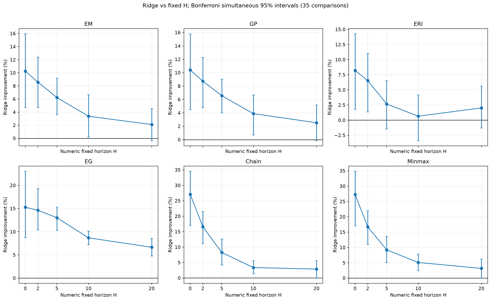

# Reliability-Aware Adaptive Lookahead for Online Container Relocation

Ridge-R selects among solver proposals at horizons **H = 0, 2, 5, 10, 20** using a frozen 74-coefficient Ridge scorer. This repository contains the necessary implementation snapshot, experimental data, statistical results, and figures for six solvers: **EM, GP, ERI, EG, Chain, and Minmax**. Leveling is included separately as a forecast-independent baseline.

## Results and scope

The fixed-horizon comparison uses **20 exposed development layouts**, two geometries with 10 layouts each, **21 conditions**, and **15,120 complete trajectory rows**. The three noise families are subset shuffle, delayed positions, and time-window shuffle; CLEAN is reported separately. Inference uses 100,000 shared geometry-stratified paired bootstrap draws and simultaneous intervals for 35 registered primary comparisons.

- The equal-six-solver noisy macro comparison supports Ridge over all five fixed horizons; its H20 improvement is **3.221%**, with simultaneous interval **[0.877%, 5.402%]**.
- Of 30 individual solver–horizon comparisons, 24 support Ridge and 6 remain unresolved. Only **EG and Minmax** support Ridge over all five horizons.
- **CLEAN is negative for all six solvers at H20**: Ridge increases relocations by 5.09%–11.09%. Delayed-position H20 point estimates are negative for five solvers.
- These are development-set results. Independent confirmation, sealed evaluation, OOD generalization, and deployment benefit are not established.

Read the [accepted results report](experiments/fixed_horizon_baselines_v1/r01/OUT/FINAL_REPORT.md) and [final acceptance receipt](experiments/fixed_horizon_baselines_v1/r01/OUT/FINAL_ACCEPTANCE.json). Historical report wording about pending acceptance is superseded by that receipt, whose status is `PASS_ROOT_FINAL_ACCEPTANCE`.



## Contents

| Path | Purpose |
|---|---|
| `R/scrp/` | Compact Ridge-only scorer/selection adapter; callers supply solver proposer callbacks |
| `Ridge_R_analysis/` | Frozen Ridge model, original Ridge-vs-NATIVE20 summaries, plotting script, PNG/PDF figures |
| `experiments/fixed_horizon_baselines_v1/r01/workspace/` | Frozen runtime sources and input layouts used by the fixed-horizon experiment; solver implementations are under `EM`, `GP`, `R`, `Chain`, and `Minmax` |
| `experiments/fixed_horizon_baselines_v1/r01/analysis/` | Merged trajectory data, tables, plot data, reports, and figures |
| `experiments/fixed_horizon_baselines_v1/r01/bank/` | Accepted fixed-horizon raw rows and compressed decision/physics/evaluator traces |
| `experiments/fixed_horizon_baselines_v1/r01/smoke/`, `bridge/` | Accepted smoke and bridge data with validation receipts |
| `Leveling/` | Standalone implementation and the 840-instance Caserta benchmark |
| `tools/reproduce_results.py` | Portable reanalysis of the included merged data and comparison with archived tables |
| `provenance/` | Release hash manifest, selection record, validation receipt, and excluded-file inventory |

The frozen runtime includes shared compatibility modules referenced by the accepted runner, even where they contain historical alternative-policy branches. It is a dependency snapshot, not an invitation to interpret those branches as additional reproduced results. GP inference inputs are retained; the earlier GP training pipeline and neural training checkpoints are outside this release.

## Reproduce the statistical results

From the repository root, with Python 3.12:

```powershell
py -3 -m pip install -r requirements.txt
py -3 -B tools/reproduce_results.py
```

This checks frozen input hashes, validates the complete paired matrix, regenerates all 12 result/plot-data CSVs and four PNG/PDF figure pairs, and compares every CSV cell to the archived results. Outputs go to `reproduced/`; the accepted files remain unchanged. It performs reanalysis only, without new trajectories or fitting. The portable script calls the byte-preserved analyzer's statistical functions; it does not invoke or change the historical stage-release gates.

The original Ridge-vs-NATIVE20 figures use earlier 10,000-draw confidence intervals. They are a separate historical analysis and must not be confused with the 100,000-draw simultaneous fixed-horizon comparison.

```powershell
py -3 -B Ridge_R_analysis/figures/gen_fig_ridge_six_solver_three_noise_families.py
py -3 -B -m pytest -q Leveling/tests
py -3 -B experiments/fixed_horizon_baselines_v1/r01/workspace/R/experiments/fixed_horizon_analysis.py --self-test
```

## Provenance and reproduction limits

The original experiment runner and its frozen dependencies are retained for inspection. Its historical release-gated commands bind absolute source paths and omitted preparation archives; **a fresh full trajectory-bank rerun is not supported by this curated release**. Statistical reanalysis and figure regeneration from the supplied data are supported and verified. Root `R/scrp/ridge_policy.py` is a reusable adapter, not a complete bank runner.

Compressed directories named `private` contain evaluator-only simulation truth/physics used in trace audits. They are published as experiment evidence; they are not actor inputs. The archival receipts retain their original paths and hash references. Some references point to preparation history deliberately kept local. [RELEASE_MANIFEST.csv](provenance/RELEASE_MANIFEST.csv) is the current release inventory; the older manifests under `provenance/` describe their original packages.

Failed engineering attempts are recorded in the accepted report and process ledger; their duplicate workspaces and raw logs are excluded. Scientific negative/unresolved results are retained. The original local research bundle was not modified.

## Third-party attribution

The Minmax source snapshot retains the upstream C++ source, [GPL-2-or-later terms](experiments/fixed_horizon_baselines_v1/r01/workspace/Minmax/COPYING), and [source provenance](experiments/fixed_horizon_baselines_v1/r01/workspace/Minmax/SOURCE_PROVENANCE.md). These terms apply to the upstream source as stated in its header. This release does not assign a blanket license to unrelated files.
