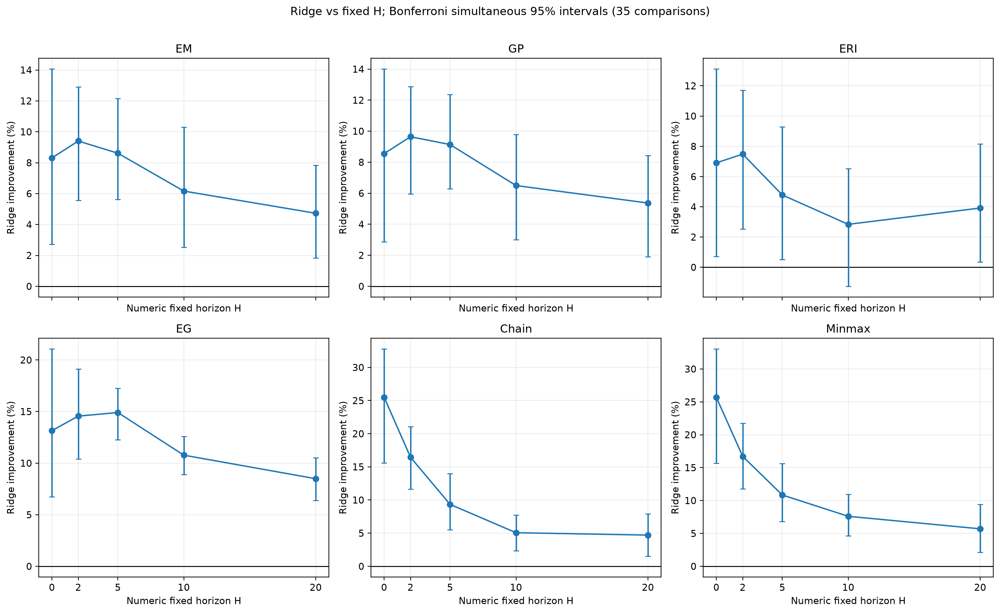

# Reliability-Aware Adaptive Lookahead for Online Container Relocation

Ridge-R selects among solver proposals at horizons **H = 0, 2, 5, 10, 20** with a frozen 74-coefficient Ridge scorer. This release includes six solver implementations, a separate Leveling baseline, input layouts, complete trajectory data, and portable experiment and statistics entrypoints.

The current evaluation covers **subset_shuffle** and **time_window_shuffle**, with **CLEAN reported separately**: 20 exposed development layouts, 15 conditions, six solvers, six policy slots, and **10,800 trajectories**. Previous-scope data and results were moved out of the current release and preserved locally. The frozen model is unchanged; all macro statistics and figures have been recomputed for the current scope.

## Find the code and data

| Directory | Contents |
|---|---|
| [baselines/](baselines/) | Visible EM, GP, ERI, EG, Chain, Minmax and Leveling entrypoints, with links to the actual implementations |
| [baselines/_snapshot/](baselines/_snapshot/) | Single source copy used by the runner; solver/policy implementations preserve their original bytes, and the statistical registration is adapted to the current two-family scope |
| [models/](models/) | Frozen Ridge coefficients and accepted GP expression/tree |
| [data/](data/) | 20 layouts, 10,800 reference trajectories, and the separate Caserta benchmark entry |
| [configs/](configs/) | Current two-family experiment matrix and execution limits |
| [reproduction/](reproduction/) | Portable runtime, simulation runner, reporting, and relative-path input hashes |
| [results/](results/) | Current-scope result tables, PNG/PDF figures, report, and reproduced execution evidence |
| [provenance/](provenance/) | Validation receipts, current file hashes and release handoff |

The visible baseline packages call the shared source snapshot. For example:

```python
from baselines.EM import make_policy
actor = make_policy("RIDGE")  # or FIXED_H0/2/5/10/20
# action, trace = actor.select(public_frame)
```

## Run the complete experiment

Tested with Python 3.12. CPU execution is sufficient.

```powershell
py -3 -m pip install -r requirements-experiments.txt
py -3 -B tools/reproduce_experiments.py --preflight --scope full
py -3 -B tools/reproduce_experiments.py --scope smoke --workers 4 --output-dir runs/smoke
py -3 -B tools/reproduce_experiments.py --scope full --workers 4 --output-dir runs/full --analyze
```

Smoke executes **216 fresh trajectories**. Full scope executes **10,800 fresh trajectories**, checks 18 deterministic fields per row against the included reference data, and then reconstructs all 12 result/plot-data CSVs and four PNG/PDF figure pairs. It uses the same forecast within each layout-condition cell and performs no fitting or model selection. The output directory must be new.

For statistics and figures using the included data without simulation:

```powershell
py -3 -m pip install -r requirements.txt
py -3 -B tools/reproduce_results.py --output-dir reproduced
```

See [complete reproduction instructions](docs/REPRODUCTION.md) for virtual environments, dependencies, individual-solver commands, traces, execution limits, failure handling, and output receipts. Historical release approvals are not required for this portable rerun.

## Current results and limits

[The two-family report](results/two_noise_families/FINAL_REPORT.md) and [all tables](results/two_noise_families/) retain both positive and negative outcomes. For the noisy equal-six macro, Ridge improves over H20 by **5.486%**, with a 35-comparison simultaneous interval of **[2.827%, 8.168%]**. Of 30 individual solver–horizon comparisons, 29 support Ridge and one remains unresolved.

**CLEAN remains negative for all six solvers at H20**: Ridge increases relocations by 5.09%–11.09%. The scope was revised after the earlier results were available; the recomputed figures are development evidence rather than a newly preregistered or independently confirmed study. No sealed/OOD generalization or deployment benefit is established.



Leveling is forecast-independent and is evaluated separately on the included 840-instance Caserta benchmark:

```powershell
py -3 -B baselines/Leveling/evaluate_caserta.py --output-dir runs/leveling-caserta
```

## Attribution and preservation

The Minmax snapshot includes the original upstream C++ source, [GPL-2-or-later terms](baselines/_snapshot/Minmax/COPYING), and [source provenance](baselines/_snapshot/Minmax/SOURCE_PROVENANCE.md). Chain's source interpretation is recorded in its [provenance](baselines/Chain/SOURCE_PROVENANCE.md). Those upstream terms do not assign a blanket license to unrelated files. The compact root `R/scrp/` export is retained for Ridge adapter reuse; the unified baseline API is the supported experiment entrypoint.

The original local research bundle and the previous-scope publication archive remain preserved. Current input and release inventories are [INPUT_MANIFEST.json](reproduction/INPUT_MANIFEST.json) and [RELEASE_MANIFEST.csv](provenance/RELEASE_MANIFEST.csv).
